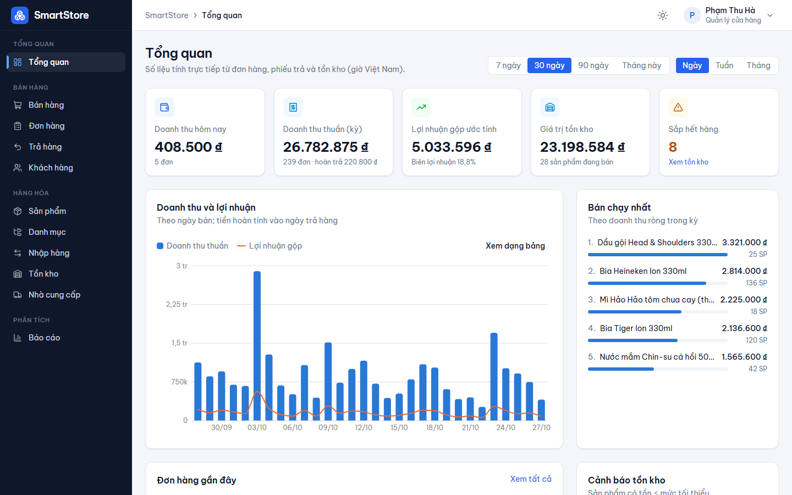
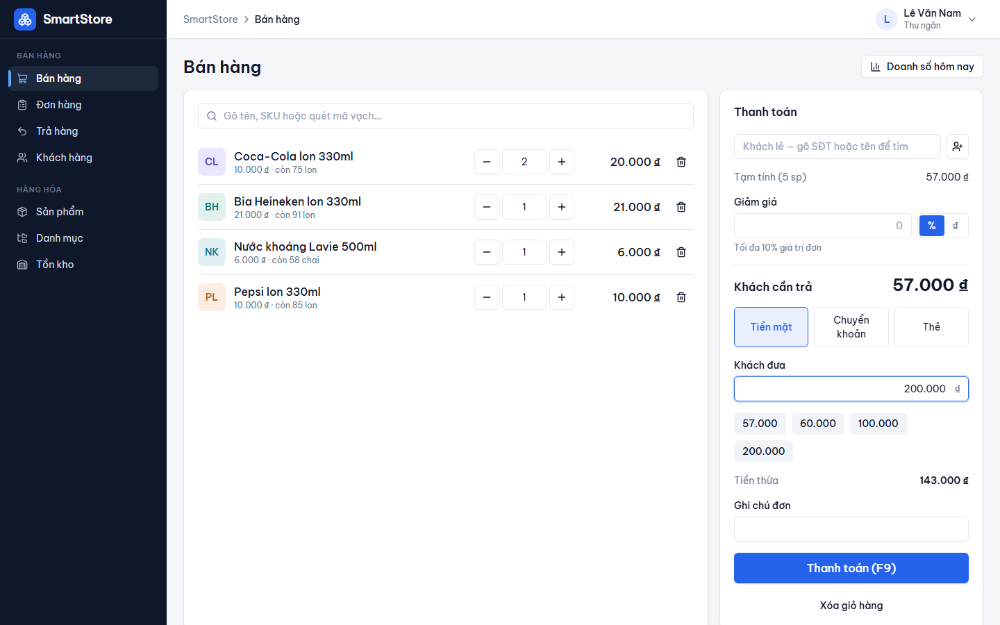
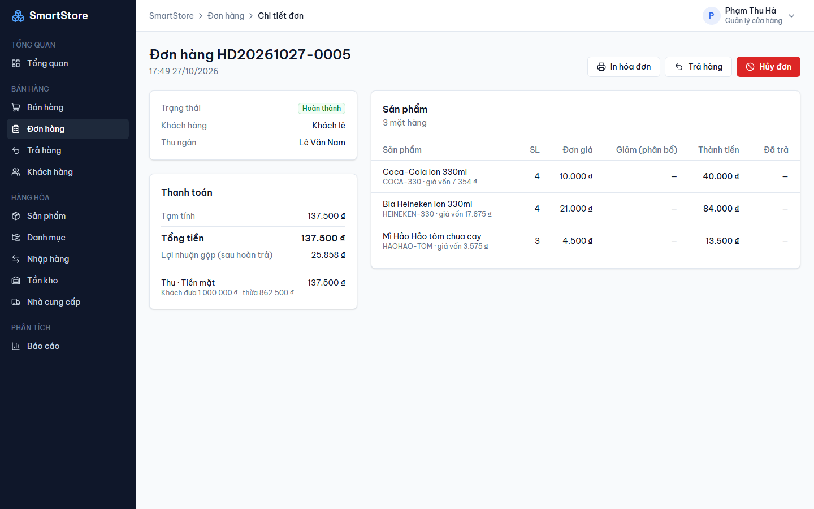
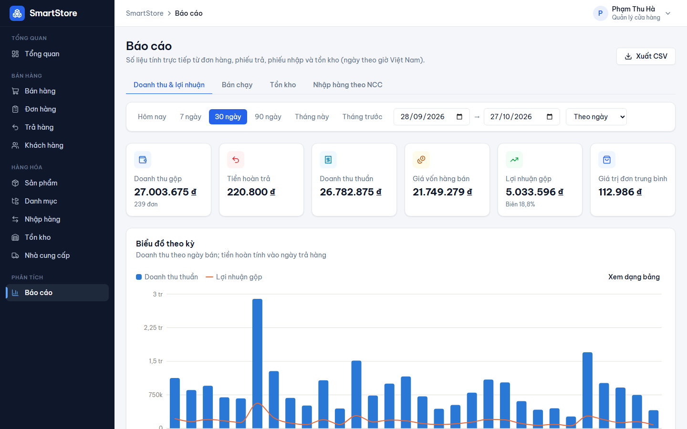
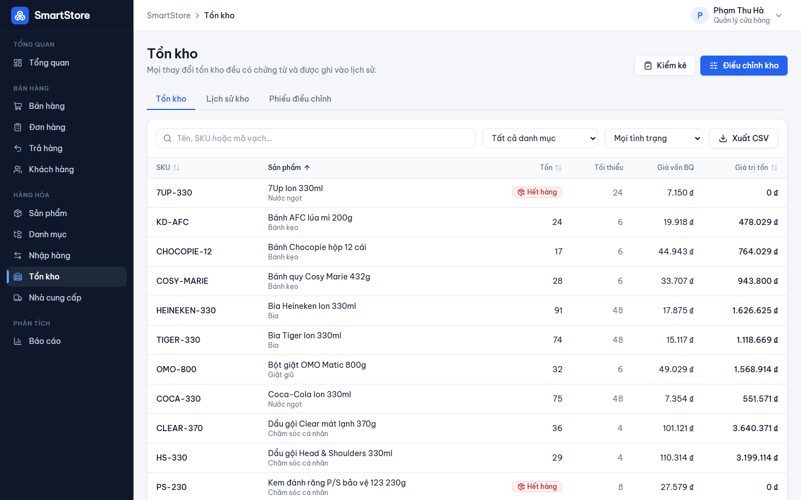

# SmartStore — Quản lý bán hàng cho cửa hàng bán lẻ

[](https://github.com/ThanhLuan04/Management_System/actions/workflows/ci.yml)

Ứng dụng web quản lý một cửa hàng bán lẻ: sản phẩm, nhập hàng, tồn kho, bán hàng tại quầy (POS), trả hàng,
khách hàng, nhân viên và báo cáo doanh thu – lợi nhuận. Dự án cá nhân để học và làm portfolio,
xây dựng theo từng giai đoạn: phân tích → thiết kế → backend → frontend → kiểm thử.



| Bán hàng tại quầy | Chi tiết đơn hàng |
|---|---|
|  |  |
| **Báo cáo doanh thu & lợi nhuận** | **Tồn kho** |
|  |  |

Thêm ảnh: [đăng nhập](docs/screenshots/01-login.png) · [đơn hàng](docs/screenshots/04-orders.png) ·
[sản phẩm](docs/screenshots/05-products.png) · [giao diện điện thoại](docs/screenshots/09-dashboard-mobile.png)

## Chức năng

- **Bán hàng (POS):** tìm sản phẩm hoặc quét mã vạch, giảm giá theo % hoặc số tiền (có giới hạn theo vai trò),
  tiền mặt / chuyển khoản / thẻ, gợi ý tiền khách đưa, in hóa đơn 80mm, phím tắt F2/F9.
- **Đơn hàng & trả hàng:** hủy đơn trong ngày, trả hàng trong thời hạn cấu hình (mặc định 7 ngày),
  hàng còn bán được nhập lại kho, hàng hỏng thì không; tiền hoàn tính theo giá sau giảm giá.
- **Nhập hàng:** phiếu nháp → xác nhận nhập kho; giá vốn bình quân gia quyền được tính lại sau mỗi lần nhập.
- **Tồn kho:** mọi thay đổi đều có chứng từ trong sổ cái kho; điều chỉnh kho và kiểm kê; cảnh báo sắp hết hàng.
- **Báo cáo:** doanh thu, giá vốn, lợi nhuận gộp theo ngày/tuần/tháng (giờ Việt Nam), sản phẩm bán chạy,
  giá trị tồn kho, nhập hàng theo nhà cung cấp; xuất CSV mở được bằng Excel.
- **Quản trị:** 3 vai trò (Admin, Quản lý, Thu ngân) với phân quyền ở backend, quản lý tài khoản,
  cài đặt cửa hàng, nhật ký thao tác (ai sửa gì, giá trị cũ → mới).

Đặc tả đầy đủ: [docs/01-business-spec.md](docs/01-business-spec.md).

## Điểm kỹ thuật

- **Tồn kho đúng khi nhiều thu ngân bán cùng lúc:** khóa dòng tồn kho bằng `SELECT … FOR UPDATE` theo thứ tự
  `product_id` (tránh deadlock); có test bắn nhiều request đồng thời vào sản phẩm cuối cùng.
- **Không tạo đơn trùng khi mạng chập chờn:** header `Idempotency-Key` cho tạo đơn và trả hàng;
  gửi lại cùng key trả về đúng đơn cũ, cùng key nhưng nội dung khác bị từ chối.
- **Lợi nhuận đúng theo thời điểm:** giá vốn được chụp lại trên từng dòng đơn lúc bán; giảm giá cấp đơn
  phân bổ xuống từng dòng để trả hàng hoàn đúng số tiền.
- **Xác thực:** access token ngắn hạn chỉ giữ trong bộ nhớ; refresh token trong cookie
  `HttpOnly`/`Secure`/`SameSite=Strict`, xoay vòng mỗi lần dùng, phát hiện dùng lại token cũ thì thu hồi mọi phiên.
  Mật khẩu băm Argon2, giới hạn số lần đăng nhập, khóa tài khoản tạm thời.
- **Bảo mật:** kiểm tra quyền trên từng endpoint, thu ngân không nhận được trường giá vốn, CORS allowlist,
  header bảo mật, lỗi không lộ stack trace, nhật ký thao tác. Chi tiết: [docs/06-security-review.md](docs/06-security-review.md).
- **Frontend:** trạng thái danh sách (lọc, sắp xếp, trang) lưu trên URL; mọi trang tải theo nhu cầu
  (bundle JS chính ~118 kB gzip; thư viện form và biểu đồ tách chunk riêng); form validate bằng Zod và hiển thị lỗi từ server đúng ô nhập.

Thiết kế database, API và cấu trúc dự án: [docs/](docs/README.md).

## Công nghệ

| Lớp | Công nghệ |
|---|---|
| Backend | Python 3.12, FastAPI, SQLAlchemy 2.1, Alembic, Pydantic v2, PostgreSQL 18, Argon2, PyJWT |
| Frontend | React 19, TypeScript, Vite, Tailwind CSS v4, TanStack Query, React Hook Form, Zod, Recharts, Radix UI |
| Kiểm thử | pytest, Vitest + React Testing Library, Playwright |
| CI | GitHub Actions: ruff, pytest, pip-audit, typecheck, Vitest, build, npm audit, E2E |

## Chạy trên máy

Cần: **Python 3.12**, **Node.js 24**, **PostgreSQL 18** (đã cài và đang chạy).

### 1. Database

Mở `psql` bằng tài khoản `postgres`:

```sql
CREATE ROLE smartstore LOGIN PASSWORD 'doi_mat_khau_nay';
CREATE DATABASE smartstore_dev OWNER smartstore;
CREATE DATABASE smartstore_test OWNER smartstore;  -- dùng cho pytest và E2E, bị xóa mỗi lần chạy test
```

### 2. Backend (thư mục `backend`)

```powershell
python -m venv .venv
.\.venv\Scripts\python.exe -m pip install -r requirements-dev.txt
copy .env.example .env          # rồi sửa mật khẩu database và JWT_SECRET_KEY trong .env
.\.venv\Scripts\python.exe -m alembic upgrade head
.\.venv\Scripts\python.exe -m scripts.create_admin --username admin --full-name "Quản trị viên"
.\.venv\Scripts\python.exe -m scripts.seed_demo          # tùy chọn: dữ liệu demo 60 ngày
.\.venv\Scripts\python.exe -m uvicorn app.main:app --reload --port 8000
```

Trên macOS/Linux dùng `.venv/bin/python` thay cho `.\.venv\Scripts\python.exe`.
Tài liệu API (Swagger): http://localhost:8000/docs

### 3. Frontend (thư mục `frontend`)

```powershell
npm install
npm run dev
```

Mở http://localhost:5173. Vite chuyển tiếp `/api` sang backend ở cổng 8000.

**Tài khoản demo** (sau khi chạy `seed_demo`): `quanly` (Quản lý), `thungan1`, `thungan2` (Thu ngân),
mật khẩu `Demo@123`. Tài khoản Admin là tài khoản bạn tạo ở bước 2.

## Kiểm thử

| Lệnh | Thư mục | Nội dung |
|---|---|---|
| `.\.venv\Scripts\python.exe -m pytest` | `backend` | Unit + integration trên `smartstore_test`: nghiệp vụ, phân quyền, đồng thời, bảo mật |
| `npm test` | `frontend` | Vitest: logic giỏ hàng, tính tiền, form, component |
| `npm run e2e` | `frontend` | Playwright trên trình duyệt thật: nhập hàng → bán → trả hàng → báo cáo; đăng nhập & phân quyền |
| `npm run screenshots` | `frontend` | Chụp lại ảnh trong `docs/screenshots` từ dữ liệu demo |

Lần đầu chạy E2E cần cài trình duyệt: `npx playwright install chromium`.
E2E tự khởi động backend (cổng 8001) và frontend (cổng 5174) riêng, dựng lại database `smartstore_test`,
nên không ảnh hưởng server và dữ liệu đang phát triển — nhưng đừng chạy cùng lúc với pytest.

## Cấu trúc

```
backend/
  app/api/v1/      endpoint theo module
  app/services/    nghiệp vụ (mỗi thao tác một transaction)
  app/models/      SQLAlchemy models
  alembic/         migration
  scripts/         tạo admin, dữ liệu demo, server E2E
  tests/           unit + integration
frontend/
  src/features/    trang và API theo module (pos, sales, catalog, inventory, reports, ...)
  src/components/  UI dùng chung
  e2e/             Playwright
docs/              đặc tả, thiết kế, rà soát bảo mật, ảnh màn hình
```

## Giới hạn hiện tại

**Chưa triển khai** (nằm ngoài phạm vi MVP, xem [đặc tả §9](docs/01-business-spec.md)):
- Xuất Excel (hiện xuất CSV), hóa đơn điện tử, kết nối cổng thanh toán (chuyển khoản/thẻ chỉ ghi nhận).
- Quên mật khẩu qua email (Admin đặt lại mật khẩu cho nhân viên).
- Hủy phiếu nhập đã xác nhận (sai sót xử lý bằng phiếu điều chỉnh kho).
- Giảm giá theo từng dòng, chương trình khuyến mãi, tích điểm khách hàng.
- Thanh toán một đơn bằng nhiều phương thức; bán theo đơn vị lẻ (kg, m) — số lượng là số nguyên.
- Nhiều chi nhánh / nhiều kho; lưu ảnh trên cloud.

**Kỹ thuật:**
- Ảnh sản phẩm lưu trên đĩa server; giới hạn đăng nhập lưu trong bộ nhớ một tiến trình
  (chạy nhiều instance cần Redis).
- Chưa đóng gói Docker và chưa deploy; HTTPS, HSTS và CSP cho trang frontend sẽ cấu hình khi deploy.
