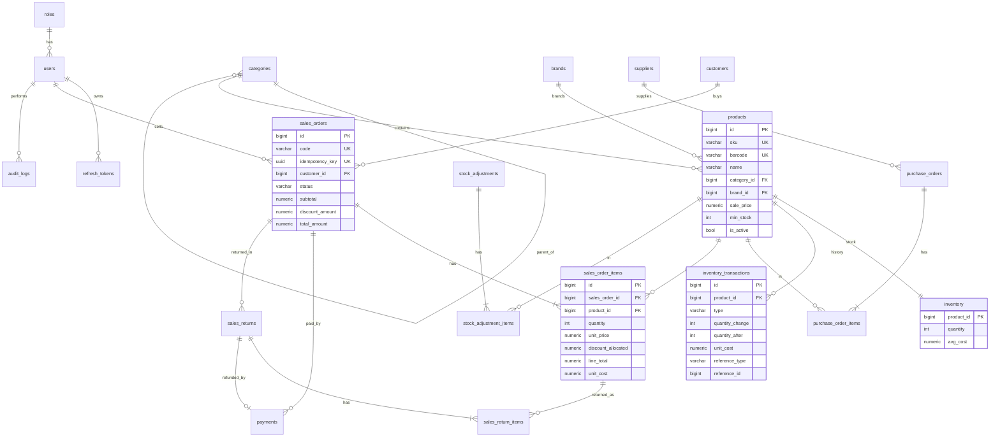

# 02 – Thiết kế cơ sở dữ liệu

DBMS: **PostgreSQL 18**. Schema được quản lý bằng **Alembic migration**: không sửa schema thủ công.

## 1. Quy ước chung

| Quy ước | Áp dụng |
|---|---|
| Tên bảng/cột | `snake_case`, tên bảng số nhiều |
| Khóa chính | `id BIGINT GENERATED BY DEFAULT AS IDENTITY` (riêng `roles.id` là `SMALLINT`, `inventory` dùng `product_id` làm PK) |
| Tiền tệ | `NUMERIC(15,2)`. Tiền bán hàng được làm tròn đến đồng ở tầng nghiệp vụ; 2 số lẻ để giá nhập lẻ được (ví dụ 100.000 / 24 chai). **Không dùng float.** |
| Giá vốn bình quân | `NUMERIC(15,4)` |
| Số lượng | `INTEGER` (MVP chỉ bán theo đơn vị nguyên) |
| Thời gian | `TIMESTAMPTZ`, lưu UTC, hiển thị theo `Asia/Ho_Chi_Minh` |
| `created_at` / `updated_at` | Mặc định `now()`; `updated_at` được SQLAlchemy cập nhật khi sửa |
| Trạng thái | `VARCHAR(20)` kèm `CHECK (status IN (...))`. Dùng VARCHAR thay cho ENUM của PostgreSQL để migration dễ thêm giá trị |
| Xóa | Không xóa cứng dữ liệu nghiệp vụ; dùng `is_active` |
| FK | Mặc định `ON DELETE RESTRICT` |

## 2. ERD



## 3. Chi tiết các bảng

### 3.1 Tài khoản và hệ thống

**roles**

| Cột | Kiểu | Ràng buộc |
|---|---|---|
| id | SMALLINT | PK |
| code | VARCHAR(20) | UNIQUE, NOT NULL. Giá trị: `ADMIN`, `MANAGER`, `CASHIER` |
| name | VARCHAR(50) | NOT NULL ("Quản trị viên", …) |

Dữ liệu được seed bằng migration. Quyền theo vai trò khai báo trong code (`app/core/permissions.py`), không lưu DB, để giữ đơn giản.

**users**

| Cột | Kiểu | Ràng buộc |
|---|---|---|
| id | BIGINT | PK |
| username | VARCHAR(50) | NOT NULL; UNIQUE INDEX trên `lower(username)` |
| password_hash | VARCHAR(255) | NOT NULL (Argon2id) |
| full_name | VARCHAR(100) | NOT NULL |
| email | VARCHAR(255) | NULL; UNIQUE INDEX trên `lower(email)` |
| phone | VARCHAR(20) | NULL |
| role_id | SMALLINT | FK → roles, NOT NULL |
| is_active | BOOLEAN | NOT NULL DEFAULT true |
| failed_login_count | SMALLINT | NOT NULL DEFAULT 0 |
| locked_until | TIMESTAMPTZ | NULL |
| last_login_at | TIMESTAMPTZ | NULL |
| created_at, updated_at | TIMESTAMPTZ | NOT NULL |

**refresh_tokens**: hỗ trợ đăng xuất và thu hồi phiên.

| Cột | Kiểu | Ràng buộc |
|---|---|---|
| id | BIGINT | PK |
| user_id | BIGINT | FK → users ON DELETE CASCADE |
| token_hash | CHAR(64) | UNIQUE (SHA-256 của token; không lưu token gốc) |
| expires_at | TIMESTAMPTZ | NOT NULL |
| revoked_at | TIMESTAMPTZ | NULL |
| user_agent | VARCHAR(255) | NULL |
| created_at | TIMESTAMPTZ | NOT NULL |

Index: `(user_id)`. Khi refresh, token cũ bị thu hồi và token mới được cấp (rotation).

**settings**: cấu hình dạng key–value.

| Cột | Kiểu | Ràng buộc |
|---|---|---|
| key | VARCHAR(50) | PK |
| value | JSONB | NOT NULL |
| updated_by | BIGINT | FK → users, NULL |
| updated_at | TIMESTAMPTZ | NOT NULL |

Các key seed sẵn: `store_name`, `store_address`, `store_phone`, `max_discount_percent_cashier` (10), `max_discount_percent_manager` (30), `return_window_days` (7).

**code_sequences**: sinh mã chứng từ tuần tự theo ngày.

| Cột | Kiểu | Ràng buộc |
|---|---|---|
| prefix | VARCHAR(10) | PK (cùng period) |
| period | VARCHAR(8) | PK (`20261025`, hoặc `ALL` cho mã khách hàng/NCC) |
| last_value | INTEGER | NOT NULL |

Lấy số tiếp theo một cách nguyên tử:

```sql
INSERT INTO code_sequences (prefix, period, last_value) VALUES ('HD', '20261025', 1)
ON CONFLICT (prefix, period) DO UPDATE SET last_value = code_sequences.last_value + 1
RETURNING last_value;
```

Câu lệnh chạy trong transaction của nghiệp vụ, nên nếu transaction rollback thì số cũng không bị "đốt".

**audit_logs**

| Cột | Kiểu | Ràng buộc |
|---|---|---|
| id | BIGINT | PK |
| user_id | BIGINT | FK → users, NULL (đăng nhập thất bại) |
| action | VARCHAR(50) | NOT NULL, ví dụ `ORDER_CANCEL`, `PRODUCT_UPDATE`, `LOGIN_FAILED` |
| entity_type | VARCHAR(50) | NULL |
| entity_id | BIGINT | NULL |
| old_values | JSONB | NULL |
| new_values | JSONB | NULL (không bao giờ chứa mật khẩu/token) |
| ip_address | VARCHAR(45) | NULL |
| created_at | TIMESTAMPTZ | NOT NULL |

Index: `(created_at DESC)`, `(entity_type, entity_id)`, `(user_id, created_at DESC)`.

### 3.2 Danh mục hàng hóa

**categories**

| Cột | Kiểu | Ràng buộc |
|---|---|---|
| id | BIGINT | PK |
| name | VARCHAR(100) | NOT NULL |
| parent_id | BIGINT | FK → categories, NULL |
| description | TEXT | NULL |
| is_active | BOOLEAN | NOT NULL DEFAULT true |
| created_at, updated_at | TIMESTAMPTZ | |

Ràng buộc: UNIQUE INDEX `(COALESCE(parent_id, 0), lower(name))`; `CHECK (parent_id <> id)`. Giới hạn 2 cấp được kiểm tra ở service.

**brands**

| Cột | Kiểu | Ràng buộc |
|---|---|---|
| id | BIGINT | PK |
| name | VARCHAR(100) | NOT NULL; UNIQUE INDEX `lower(name)` |
| is_active | BOOLEAN | NOT NULL DEFAULT true |
| created_at, updated_at | TIMESTAMPTZ | |

**products**

| Cột | Kiểu | Ràng buộc |
|---|---|---|
| id | BIGINT | PK |
| sku | VARCHAR(50) | NOT NULL, UNIQUE (đã chuẩn hóa viết hoa) |
| barcode | VARCHAR(50) | NULL, UNIQUE |
| name | VARCHAR(255) | NOT NULL |
| category_id | BIGINT | FK → categories, NOT NULL |
| brand_id | BIGINT | FK → brands, NULL |
| unit | VARCHAR(20) | NOT NULL (cái, hộp, chai, gói…) |
| sale_price | NUMERIC(15,2) | NOT NULL, `CHECK (sale_price >= 0)` |
| min_stock | INTEGER | NOT NULL DEFAULT 0, `CHECK (min_stock >= 0)` |
| image_path | VARCHAR(255) | NULL |
| description | TEXT | NULL |
| is_active | BOOLEAN | NOT NULL DEFAULT true |
| created_by | BIGINT | FK → users |
| created_at, updated_at | TIMESTAMPTZ | |

Index: `(category_id)`, `(is_active)`, và GIN trigram trên `name` (extension `pg_trgm`) để tìm theo tên nhanh với `ILIKE '%...%'`.

> Bảng `products` **không có cột giá vốn hay tồn kho**. Hai giá trị này thuộc về `inventory`, để không có hai nguồn dữ liệu cho cùng một con số.

### 3.3 Tồn kho

**inventory**: trạng thái tồn hiện tại. Đây là dòng được khóa khi bán hoặc nhập.

| Cột | Kiểu | Ràng buộc |
|---|---|---|
| product_id | BIGINT | PK, FK → products |
| quantity | INTEGER | NOT NULL DEFAULT 0, **`CHECK (quantity >= 0)`** |
| avg_cost | NUMERIC(15,4) | NOT NULL DEFAULT 0, `CHECK (avg_cost >= 0)` |
| updated_at | TIMESTAMPTZ | NOT NULL |

Dòng `inventory` được tạo cùng lúc với sản phẩm (SL 0, avg 0), trong cùng transaction.

> Vì sao lưu `quantity` thay vì luôn tính `SUM(inventory_transactions)`? Cần một dòng cụ thể để **khóa** (`FOR UPDATE`) khi bán đồng thời, và việc đọc tồn phải nhanh. Tính nhất quán được đảm bảo bằng việc chỉ service mới cập nhật dòng này, luôn kèm một dòng lịch sử. Sẽ có test đối soát `quantity = SUM(quantity_change)`.

**inventory_transactions**: sổ cái kho, chỉ thêm, không sửa, không xóa.

| Cột | Kiểu | Ràng buộc |
|---|---|---|
| id | BIGINT | PK |
| product_id | BIGINT | FK → products, NOT NULL |
| type | VARCHAR(20) | `CHECK IN ('PURCHASE','SALE','SALE_RETURN','ORDER_CANCEL','ADJUSTMENT')` |
| quantity_change | INTEGER | NOT NULL, `CHECK (quantity_change <> 0)` |
| quantity_after | INTEGER | NOT NULL, `CHECK (quantity_after >= 0)` |
| unit_cost | NUMERIC(15,4) | NOT NULL (giá vốn áp dụng cho biến động) |
| avg_cost_after | NUMERIC(15,4) | NOT NULL |
| reference_type | VARCHAR(30) | NOT NULL (`purchase_order`, `sales_order`, `sales_return`, `stock_adjustment`) |
| reference_id | BIGINT | NOT NULL |
| note | VARCHAR(255) | NULL |
| created_by | BIGINT | FK → users, NOT NULL |
| created_at | TIMESTAMPTZ | NOT NULL |

Index: `(product_id, created_at DESC)`, `(type, created_at)`, `(reference_type, reference_id)`.

**stock_adjustments**

| Cột | Kiểu | Ràng buộc |
|---|---|---|
| id | BIGINT | PK |
| code | VARCHAR(20) | UNIQUE (`DC20261025-0001`) |
| type | VARCHAR(20) | `CHECK IN ('ADJUSTMENT','STOCKTAKE')` |
| reason | VARCHAR(255) | NOT NULL |
| note | TEXT | NULL |
| created_by | BIGINT | FK → users |
| created_at | TIMESTAMPTZ | NOT NULL |

**stock_adjustment_items**

| Cột | Kiểu | Ràng buộc |
|---|---|---|
| id | BIGINT | PK |
| stock_adjustment_id | BIGINT | FK → stock_adjustments ON DELETE CASCADE |
| product_id | BIGINT | FK → products |
| quantity_before | INTEGER | NOT NULL |
| quantity_change | INTEGER | NOT NULL, `<> 0` |
| counted_quantity | INTEGER | NULL (chỉ có với STOCKTAKE) |
| unit_cost | NUMERIC(15,4) | NOT NULL |

UNIQUE `(stock_adjustment_id, product_id)`.

### 3.4 Đối tác

**suppliers**

| Cột | Kiểu | Ràng buộc |
|---|---|---|
| id | BIGINT | PK |
| code | VARCHAR(20) | UNIQUE (`NCC0001`, tự sinh) |
| name | VARCHAR(255) | NOT NULL |
| contact_name | VARCHAR(100) | NULL |
| phone | VARCHAR(20) | NULL |
| email | VARCHAR(255) | NULL |
| address | VARCHAR(500) | NULL |
| tax_code | VARCHAR(20) | NULL |
| note | TEXT | NULL |
| is_active | BOOLEAN | NOT NULL DEFAULT true |
| created_at, updated_at | TIMESTAMPTZ | |

**customers**

| Cột | Kiểu | Ràng buộc |
|---|---|---|
| id | BIGINT | PK |
| code | VARCHAR(20) | UNIQUE (`KH000001`) |
| name | VARCHAR(255) | NOT NULL |
| phone | VARCHAR(20) | NULL, UNIQUE (dùng để tra cứu nhanh ở POS) |
| email | VARCHAR(255) | NULL |
| address | VARCHAR(500) | NULL |
| note | TEXT | NULL |
| is_active | BOOLEAN | NOT NULL DEFAULT true |
| created_at, updated_at | TIMESTAMPTZ | |

Không lưu "tổng chi tiêu" hay "số đơn". Hai giá trị này được tính bằng truy vấn trên `sales_orders` và `sales_returns`.

### 3.5 Nhập hàng

**purchase_orders**

| Cột | Kiểu | Ràng buộc |
|---|---|---|
| id | BIGINT | PK |
| code | VARCHAR(20) | UNIQUE (`PN20261025-0001`) |
| supplier_id | BIGINT | FK → suppliers, NOT NULL |
| status | VARCHAR(20) | `CHECK IN ('DRAFT','CONFIRMED','CANCELLED')` |
| total_amount | NUMERIC(15,2) | NOT NULL, `>= 0` |
| note | TEXT | NULL |
| created_by | BIGINT | FK → users |
| confirmed_by | BIGINT | FK → users, NULL |
| confirmed_at | TIMESTAMPTZ | NULL |
| cancelled_by | BIGINT | FK → users, NULL |
| cancelled_at | TIMESTAMPTZ | NULL |
| created_at, updated_at | TIMESTAMPTZ | |

`CHECK ((status = 'CONFIRMED') = (confirmed_at IS NOT NULL))`. Index: `(supplier_id)`, `(status, created_at DESC)`.

**purchase_order_items**

| Cột | Kiểu | Ràng buộc |
|---|---|---|
| id | BIGINT | PK |
| purchase_order_id | BIGINT | FK → purchase_orders ON DELETE CASCADE |
| product_id | BIGINT | FK → products |
| quantity | INTEGER | `CHECK (quantity > 0)` |
| unit_cost | NUMERIC(15,2) | `>= 0` |
| discount_amount | NUMERIC(15,2) | `>= 0`, `<= quantity × unit_cost` |
| line_total | NUMERIC(15,2) | `= quantity × unit_cost − discount_amount` |

UNIQUE `(purchase_order_id, product_id)`.

> `total_amount` và `line_total` là dữ liệu tính được, nhưng vẫn lưu lại vì đây là **chứng từ tài chính**: sau khi xác nhận, số liệu phải giữ nguyên như lúc ký nhận. Đơn bán hàng cũng áp dụng cùng nguyên tắc.

### 3.6 Bán hàng, thanh toán, hoàn trả

**sales_orders**

| Cột | Kiểu | Ràng buộc |
|---|---|---|
| id | BIGINT | PK |
| code | VARCHAR(20) | UNIQUE (`HD20261025-0001`) |
| idempotency_key | UUID | UNIQUE, NOT NULL |
| customer_id | BIGINT | FK → customers, NULL (khách lẻ) |
| status | VARCHAR(20) | `CHECK IN ('COMPLETED','CANCELLED')` |
| subtotal | NUMERIC(15,2) | `>= 0` |
| discount_type | VARCHAR(10) | NULL, `IN ('AMOUNT','PERCENT')` |
| discount_value | NUMERIC(15,2) | NOT NULL DEFAULT 0 |
| discount_amount | NUMERIC(15,2) | `>= 0 AND <= subtotal` |
| total_amount | NUMERIC(15,2) | `= subtotal − discount_amount` |
| note | VARCHAR(500) | NULL |
| created_by | BIGINT | FK → users (thu ngân) |
| created_at | TIMESTAMPTZ | NOT NULL (thời điểm bán) |
| cancelled_by | BIGINT | FK → users, NULL |
| cancelled_at | TIMESTAMPTZ | NULL |
| cancel_reason | VARCHAR(255) | NULL |
| updated_at | TIMESTAMPTZ | |

Index: `(created_at DESC)`, `(status, created_at)`, `(customer_id, created_at DESC)`, `(created_by, created_at)`.

**sales_order_items**

| Cột | Kiểu | Ràng buộc |
|---|---|---|
| id | BIGINT | PK |
| sales_order_id | BIGINT | FK → sales_orders ON DELETE CASCADE |
| product_id | BIGINT | FK → products |
| product_name | VARCHAR(255) | Snapshot tại thời điểm bán |
| sku | VARCHAR(50) | Snapshot |
| unit | VARCHAR(20) | Snapshot |
| quantity | INTEGER | `> 0` |
| unit_price | NUMERIC(15,2) | Giá bán tại thời điểm giao dịch |
| line_subtotal | NUMERIC(15,2) | `= quantity × unit_price` |
| discount_allocated | NUMERIC(15,2) | `>= 0` |
| line_total | NUMERIC(15,2) | `= line_subtotal − discount_allocated` |
| unit_cost | NUMERIC(15,4) | avg_cost tại thời điểm bán |

UNIQUE `(sales_order_id, product_id)`. Index `(product_id)` (dùng cho báo cáo top sản phẩm).

**payments**

| Cột | Kiểu | Ràng buộc |
|---|---|---|
| id | BIGINT | PK |
| sales_order_id | BIGINT | FK → sales_orders, NOT NULL |
| sales_return_id | BIGINT | FK → sales_returns, NULL |
| type | VARCHAR(10) | `IN ('PAYMENT','REFUND')` |
| method | VARCHAR(20) | `IN ('CASH','BANK_TRANSFER','CARD')` |
| amount | NUMERIC(15,2) | `> 0` |
| cash_received | NUMERIC(15,2) | NULL (chỉ có với CASH + PAYMENT) |
| change_amount | NUMERIC(15,2) | NULL |
| reference_note | VARCHAR(100) | NULL (mã giao dịch chuyển khoản nhập tay) |
| created_by | BIGINT | FK → users |
| created_at | TIMESTAMPTZ | NOT NULL |

**sales_returns**

| Cột | Kiểu | Ràng buộc |
|---|---|---|
| id | BIGINT | PK |
| code | VARCHAR(20) | UNIQUE (`TH20261025-0001`) |
| idempotency_key | UUID | UNIQUE, NOT NULL |
| sales_order_id | BIGINT | FK → sales_orders |
| reason | VARCHAR(255) | NOT NULL |
| total_refund | NUMERIC(15,2) | `>= 0` |
| created_by | BIGINT | FK → users |
| created_at | TIMESTAMPTZ | NOT NULL |

Index: `(sales_order_id)`, `(created_at)`.

**sales_return_items**

| Cột | Kiểu | Ràng buộc |
|---|---|---|
| id | BIGINT | PK |
| sales_return_id | BIGINT | FK → sales_returns ON DELETE CASCADE |
| sales_order_item_id | BIGINT | FK → sales_order_items |
| product_id | BIGINT | FK → products |
| quantity | INTEGER | `> 0` |
| condition | VARCHAR(20) | `IN ('RESELLABLE','DAMAGED')` |
| refund_amount | NUMERIC(15,2) | `>= 0` |
| unit_cost | NUMERIC(15,4) | Copy từ dòng đơn gốc |

## 4. Dữ liệu thay đổi thế nào trong từng nghiệp vụ

### 4.1 Xác nhận phiếu nhập PN20261025-0001 (20 hộp sữa, giá 9.500)

Trạng thái ban đầu: `inventory(product 12) = {quantity: 10, avg_cost: 8000}`.

| Bước | Bảng | Thay đổi |
|---|---|---|
| 1 | purchase_orders | `UPDATE ... SET status='CONFIRMED', confirmed_by, confirmed_at WHERE id=5 AND status='DRAFT'` |
| 2 | inventory | `SELECT ... FOR UPDATE` → quantity 10→30, avg_cost 8000→9000 |
| 3 | inventory_transactions | INSERT `{PURCHASE, +20, after 30, unit_cost 9500, avg_after 9000, purchase_order #5}` |
| 4 | audit_logs | INSERT `PURCHASE_CONFIRM` |

### 4.2 Bán đơn HD20261025-0007 (5 hộp sữa × 12.000, giảm 10%)

| Bước | Bảng | Thay đổi |
|---|---|---|
| 1 | code_sequences | HD/20261025: 6 → 7 |
| 2 | inventory | FOR UPDATE, kiểm tra 30 ≥ 5 → quantity 30→25 |
| 3 | sales_orders | INSERT `{subtotal 60000, discount 6000, total 54000, COMPLETED}` |
| 4 | sales_order_items | INSERT `{qty 5, unit_price 12000, discount_allocated 6000, line_total 54000, unit_cost 9000}` |
| 5 | inventory_transactions | INSERT `{SALE, −5, after 25, unit_cost 9000}` |
| 6 | payments | INSERT `{PAYMENT, CASH, 54000, cash_received 100000, change 46000}` |

Lợi nhuận gộp của đơn = 54.000 − 5 × 9.000 = **9.000 đ**.

### 4.3 Khách trả 2 hộp (còn tốt) của đơn trên

| Bước | Bảng | Thay đổi |
|---|---|---|
| 1 | sales_orders | `SELECT ... FOR UPDATE` (tuần tự hóa các lần trả của cùng một đơn) |
| 2 | — | Kiểm tra: 2 ≤ 5 − 0; trong hạn 7 ngày |
| 3 | inventory | quantity 25→27, avg tính lại với giá 9.000 |
| 4 | sales_returns + items | refund = round(54000 × 2/5) = **21.600** |
| 5 | inventory_transactions | `{SALE_RETURN, +2, unit_cost 9000}` |
| 6 | payments | `{REFUND, CASH, 21600, sales_return_id}` |

Báo cáo: doanh thu thuần = 54.000 − 21.600 = 32.400. COGS = 45.000 − 18.000 = 27.000. Lợi nhuận gộp = **5.400 đ**.

## 5. Xử lý đồng thời

**Tình huống:** còn 1 hộp sữa. Thu ngân A và B cùng bấm "Thanh toán" gần như cùng lúc.

```
T1 (A): BEGIN; SELECT * FROM inventory WHERE product_id IN (12) ORDER BY product_id FOR UPDATE;  -- lấy được khóa
T2 (B): BEGIN; SELECT ... FOR UPDATE;                                                             -- CHỜ
T1 (A): quantity 1 ≥ 1 → UPDATE quantity = 0; INSERT order...; COMMIT;                              -- nhả khóa
T2 (B): đọc lại quantity = 0 < 1 → raise OUT_OF_STOCK → ROLLBACK → HTTP 409
```

- **Khóa theo thứ tự `product_id` tăng dần**: hai đơn có cùng sản phẩm X và Y luôn khóa X trước rồi mới tới Y, nên không thể xảy ra deadlock.
- **Lớp bảo vệ cuối:** ràng buộc `CHECK (quantity >= 0)` làm DB từ chối mọi câu lệnh khiến tồn âm, kể cả khi code có lỗi.
- **Chống gửi trùng:** `idempotency_key UNIQUE`. Nếu hai request cùng key chạy song song, request thứ hai vi phạm UNIQUE; backend bắt lỗi đó, rollback và trả về đơn đã tạo.
- **Mức isolation:** dùng READ COMMITTED (mặc định của PostgreSQL) kết hợp khóa hàng tường minh. Mức này đủ dùng và dễ giải thích hơn SERIALIZABLE (vốn đòi hỏi phải tự retry).
- **Khi transaction thất bại:** toàn bộ thay đổi bị rollback, nên không thể có đơn mà chưa trừ kho. Frontend giữ nguyên giỏ hàng và cùng Idempotency-Key để người dùng thử lại an toàn.

## 6. Thứ tự migration dự kiến

1. `roles`, `users`, `refresh_tokens`, `settings`, `code_sequences`, `audit_logs` + seed roles và settings
2. `categories`, `brands`, `products`, `inventory` + extension `pg_trgm`
3. `suppliers`, `customers`
4. `purchase_orders`, `purchase_order_items`, `inventory_transactions`, `stock_adjustments`, `stock_adjustment_items`
5. `sales_orders`, `sales_order_items`, `payments`, `sales_returns`, `sales_return_items`
